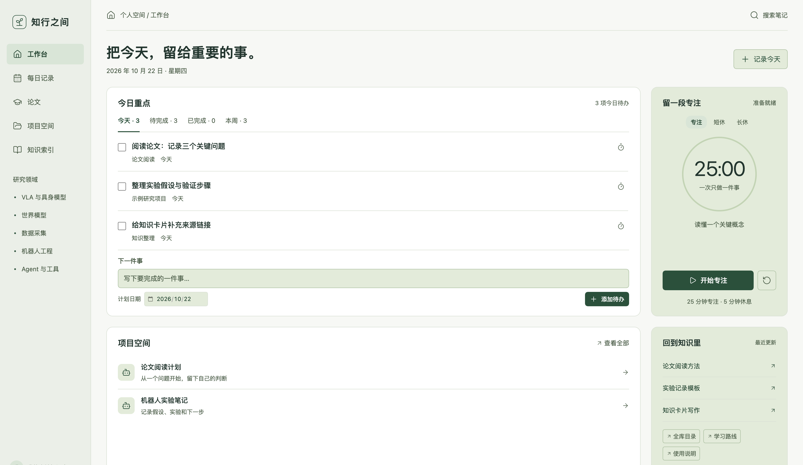
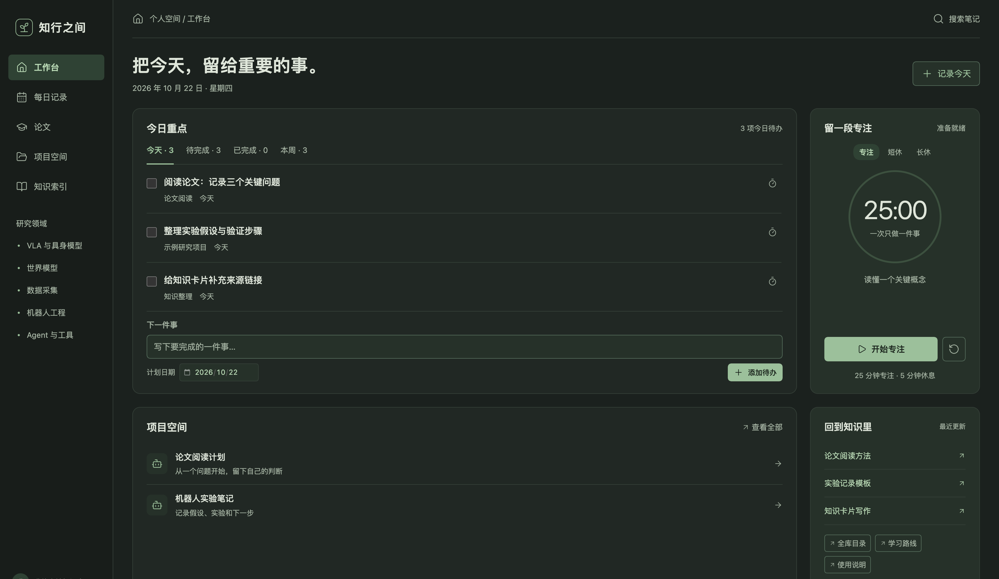
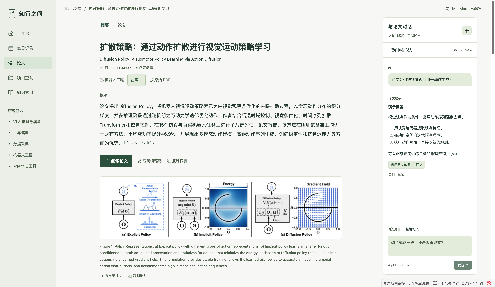
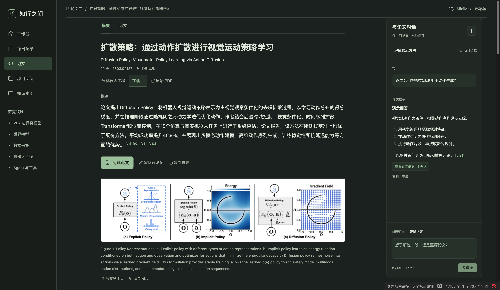
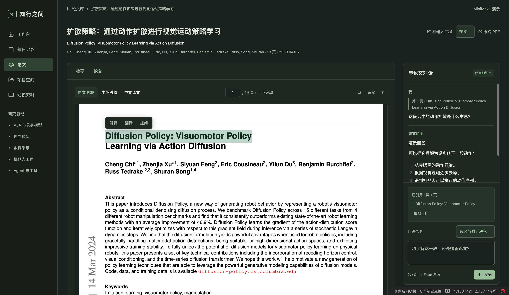
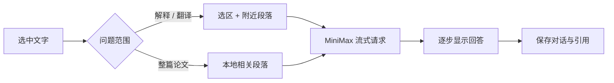

<div align="center">

# 知行之间 · Obsidian 工作台

**把任务、记录和论文阅读，放回同一张书桌。**

本地 Markdown · 专注计时 · 每日记录 · 论文分类 · 双语 PDF · 流式选区问答


</div>



> 截图使用虚构任务与演示内容，不包含作者的私人笔记、实际对话或 API 密钥。当前为私人维护的桌面插件，未上架 Obsidian 社区市场。

## 一张书桌，四种工作

| 工作 | 可以做什么 |
| --- | --- |
| 安排今天 | 汇总 Markdown 待办，按今天／待完成／已完成／本周筛选；勾选会写回源笔记 |
| 专注与记录 | 番茄时钟、每日记录、输入法语音输入、AI 整理、选择性保存待办 |
| 回到知识 | 项目目录、知识索引、主题导航；保留 Markdown 文件作为事实来源 |
| 阅读论文 | PDF/arXiv 导入、分类、摘要、连续滚动、保留版式的中文／中英对照、带页码的选区问答 |

### 跟随系统的浅色与深色

插件遵循 Obsidian 当前主题；在 Obsidian 外观中选择“适应系统”即可跟随系统切换。



### assistant-ui 论文对话

右侧聊天栏使用 [assistant-ui](https://github.com/assistant-ui/assistant-ui) 的 React 组件与 LocalRuntime，负责流式 Markdown、自动滚动、停止、复制、重试及回答版本切换。每篇论文可以新建、切换和重命名多个会话，草稿与分支记录保存在该论文的本地 `paper.json`。原有聊天会自动导入「原有对话」，旧字段保留以便回退。

引用按钮可预览原文并跳转到 PDF 页码；选区仍直接交给 MiniMax，不经过额外云端聊天服务。使用自定义模型和历史适配器，不使用 assistant-cloud 账户或云端存储。



<details>
<summary>查看深色聊天栏</summary>



</details>

### 选中就问，边生成边读

摘要页采用文章式阅读布局：标题与概览、连续 AI 解读、章节导航和行内页码引用。点击页码查看原文依据，再跳到对应 PDF 页；阅读笔记默认折叠，可从「写阅读笔记」打开。界面跟随 Obsidian 的深浅色主题。

- **原文配图**：本地分析 PDF 前 24 页的图注和图形位置，最多自动提取 3 张配图（包括矢量架构图、曲线和照片），插入概览、方法或结果段落。点击图片可放大，图下注明原始图注和页码。复杂版式或扫描件可能无法自动识别。
- **选中复制**：摘要正文可以拖选后按 `⌘C` / `Ctrl+C`，也可以右键复制。阅读笔记和聊天输入框支持正常粘贴。
- **图文复制**：「复制摘要」同时写入富文本和 Markdown；支持富文本的目标可粘贴图片与文字，纯文本目标得到文字与本地图片路径。每张图也可单独「复制图片」或右键复制，再粘贴到 Obsidian、Word 等支持图片的编辑器。

配图来自原始论文，图注保留原文；这一步不调用模型。缓存保存在对应论文目录的 `figures/` 下，不会上传到本仓库。

1. 在论文中拖选文字，选区旁出现 **解释 / 翻译 / 提问**。
2. 解释、翻译直接发送；提问将输入焦点移到右侧。
3. 默认只提供 **选区及附近原文**，不用为解释一句话准备整篇论文。
4. 跨章节问题可切换 **整篇论文**，使用本地提取文字选择相关段落。
5. 回答通过 SSE 逐步显示；可停止请求、保留部分回答并重试。



截图中的论文为公开的 [Diffusion Policy](https://arxiv.org/abs/2303.04137)，聊天内容为明确标注的演示示例；仓库不包含论文 PDF。

回答保留选区与页码，可通过引用回到原文。选中文字不会写入永久 PDF 高亮批注。扫描件需要先 OCR；聊天目前使用提取文字，不具备可靠的图表视觉理解。



## 快速安装

### 下载已构建版本

从 [Releases](https://github.com/Pytorchlover/obsidian-zhixing-workbench/releases) 下载 `zhixing-research-desk.zip`，解压后将整个 `zhixing-research-desk` 文件夹放入：

```text
你的知识库/.obsidian/plugins/zhixing-research-desk/
├── main.js
├── manifest.json
├── styles.css
└── pdf-layout-worker.py
```

重启 Obsidian，在 **设置 → 第三方插件** 启用「知行之间 · 个人工作台」，然后用命令面板执行 **打开个人工作台**。

- 需要 Obsidian 桌面版 1.13+；macOS + Obsidian 1.13.7 已验证。
- Windows/Linux 未完成端到端验收，PDF 翻译安装脚本目前按 macOS/Linux 用户目录布局编写。
- 不需要 Dataview；任务、目录和阅读视图由插件直接提供。
- 本地任务、专注计时和阅读不需要模型密钥。

### 从源码构建

需要 Node.js 22+、Python 3。源码构建使用 npm 依赖；安装构建包后不需要 Node.js。

```sh
git clone git@github.com:Pytorchlover/obsidian-zhixing-workbench.git
cd obsidian-zhixing-workbench
npm ci
npm run typecheck
npm test
npm run build
python3 scripts/install.py --vault "/path/to/your/vault"
```

安装脚本只复制插件文件，不复制笔记、密钥或样例。目标插件已存在时默认拒绝覆盖；自行备份后才使用 `--force`。

### 新知识库的目录约定

可以先用 [examples/vault](examples/vault) 里的虚构示例试用。向已有知识库合并示例时，请保留自己的同名文件。

```text
知识库首页.md
项目总览.md
wiki/
  index.md                  # 知识索引
  Tools/                    # 知识卡片
projects/
  示例项目/_context.md       # 项目入口
  个人工作台/
    日记/                   # 每日记录
    论文库/                 # 提取文字、对话、摘要、译文 PDF
raw/assets/papers/          # 原始 PDF
templates/                 # 可选笔记模板
```

侧栏目前提供 VLA、世界模型、数据采集、机器人工程、Agent 等研究主题，适合具身智能研究工作流。目录和主题仍有固定约定；要调整它们，请修改 `src/main.js`、`src/navigation.js`、`src/daily.js` 和 `src/papers.js` 后重新构建。

在任意笔记中嵌入工作台：

````markdown
```zhixing-desk
```
````

## 配置 MiniMax

点击每日记录或论文页右上角 **配置 AI**，填写自己的 MiniMax 国区密钥。当前使用 `MiniMax-M3.1-Flash` 和 `https://api.minimax.cn/v1/chat/completions`；账户需要有对应模型权限及可用额度。

- 日记：仅在点击 AI 整理时发送本次记录与日期。
- 选区问答：发送问题、选区、附近段落及近期对话。
- 全文问答：发送本篇论文的相关段落，不搜索其他私人笔记。
- 摘要／全文翻译：主动执行时会发送对应论文文本。
- 流式问答通过 Node HTTPS 发起；受限网络可能需要额外网络配置，当前没有单独的代理设置界面。

**不要将密钥写进源码、笔记或 `.env` 后提交。** 插件使用 Electron `safeStorage`，按知识库路径区分，保存在知识库之外的本机加密文件中。系统加密不可用时拒绝写入密钥。当前加密存储目录布局主要面向 macOS。

## 保留版式的中文 / 中英对照 PDF

这一能力复用独立的 **PDF2zh Next + BabelDOC** 用户级环境，不会修改原始 PDF。首次安装需要 [uv](https://docs.astral.sh/uv/)。

```sh
sh scripts/setup-pdf-layout.sh
```

固定版本：`pdf2zh-next==2.9.0`、`babeldoc==0.6.2`、`bitstring==4.4.0`。首次会下载模型与字体资源，需要网络和磁盘空间。

打开一篇论文 → **论文 → 中文译文 / 中英对照 → 生成中文与对照 PDF**。生成后本地缓存，切换版本不用再次翻译。中英对照为左原文、右译文；三个版本均支持纵向连续滚动。

全文翻译会消耗模型额度，并可能需要数分钟或更久。复杂表格、公式、专名及扫描件仍需人工核对。

## 数据与隐私

| 内容 | 保存位置 | 本仓库是否包含 |
| --- | --- | --- |
| 插件代码、样式、模板 | 本仓库 | 是 |
| 模型密钥、日记草稿 | 知识库之外的本机加密存储 | **否** |
| 私人笔记、论文、聊天记录 | 用户自己的知识库 | **否** |
| 任务与计时状态 | 用户的笔记和插件运行数据 | **否** |
| README 截图 | 独立演示内容 | 是 |

`.gitignore` 和 `npm run scan` 会排除或检查常见密钥、个人绝对路径及运行数据。正则扫描不是泄密的绝对保证，发布前仍应检查暂存区和截图。

## 开发与验证

```sh
npm test       # 46 项离线检查；不访问真实账户或知识库
npm run build  # 单文件插件 + 安装 zip
npm run scan   # 检查源文件和构建产物
```

检查包括 Markdown 写回与冲突保护、日记数据完整性、论文引用校验、PDF 生成失败保护、SSE 分片与 UTF-8、取消、超时及选区上下文范围。

实际桌面验证还覆盖了选区快捷操作、增量显示、停止重试，以及使用真实 MiniMax 返回流式内容；网络耗时不是固定性能承诺。详见 [架构与维护](docs/ARCHITECTURE.md)。

```text
src/       工作台、日记、论文、阅读器、流式服务与样式
scripts/   构建、安装、隐私检查、PDF 翻译运行时
tests/     无网络单元测试
examples/  虚构的示例知识库
docs/      截图与维护说明
```

## 已知边界

- 当前为桌面插件，未适配移动端。
- 单篇导入上限 35 MB、120 页；扫描件需先 OCR。
- 全文问答使用本地关键词相关段落选择，不是完整的向量数据库检索系统。
- 停止请求会关闭本地连接，但不保证服务商立即停止计费。
- 选择引用不等于永久 PDF 批注；语音输入由操作系统或输入法提供。
- AI 回答可能有误；无有效引用的全文回答会提示核对。

## 第三方组件与授权

PDF 阅读使用 Obsidian 提供的 PDF.js；保留版式翻译依赖独立安装的 PDF2zh Next / BabelDOC。版本、来源与许可证见 [THIRD_PARTY.md](THIRD_PARTY.md)。

本仓库当前为私有维护，尚未为原创代码指定公开分发许可证；第三方组件各自的许可证继续适用。
